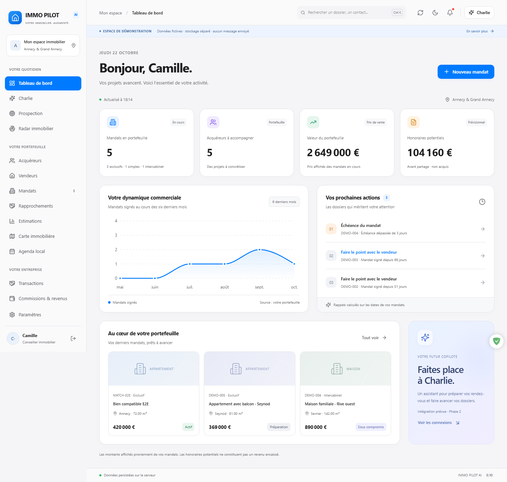

# IMMO PILOT AI

Poste de travail immobilier pour Annecy et le Grand Annecy. **Version 0.4 — compte privé local et mises à jour intégrées.**

## Installer sous Windows

Télécharger le fichier `IMMO-PILOT-AI_0.4.0_x64-setup.exe` depuis [la dernière version](https://github.com/colonelchaboumm/vwimo/releases/latest), puis l’installer et ouvrir l’application. Le backend Python est inclus et lancé automatiquement. Aucun terminal, Node ou Python à installer séparément.

Cette première installation active les mises à jour futures : une icône de téléchargement devient bleue lorsqu’une version est disponible. Cliquer dessus, lire les nouveautés puis choisir **Installer et redémarrer**. Les paquets sont vérifiés par signature avant installation ; les données restent dans le profil Windows. [Détails et procédure de publication](docs/MISES-A-JOUR.md).

Au premier lancement, créez votre compte local avec votre nom, votre e-mail et un mot de passe de 12 caractères minimum. Aucun hébergement ni vérification par e-mail : les identifiants et dossiers restent sur cet ordinateur. Le mot de passe est conservé sous forme d’empreinte Argon2id. Un seul propriétaire est accepté par espace local. Les intégrations IA/Outlook ne sont pas encore activées. La signature des mises à jour ne remplace pas un certificat Windows Authenticode.

## Fonctionnalités

- Tableau de bord calculé, signatures, échéances et priorités.
- Contacts vendeurs/acquéreurs, critères de recherche, budgets, recherche sans accents, tri, export CSV et archivage contrôlé.
- Mandats : bien, vendeur, prix, honoraires, dates, statut, DPE et conditions intercabinets.
- Documents PDF, DOCX, XLSX, JPG et PNG : import, association et téléchargement authentifié avec contrôle d’intégrité.
- Authentification Argon2, sessions expirables, rôles et historique des modifications.
- Protection des saisies, conflits de modification détectés, modes clair/sombre et design inspiré de macOS.
- Backend embarqué, stockage persistant hors installation, sauvegarde avant migration et mises à jour signées depuis GitHub.

## Développer

```powershell
.\scripts\setup.ps1
.\scripts\start.ps1
```

Prérequis de développement : Python 3.12+ et Node 20.19+. Ouvrir http://127.0.0.1:1420 puis créer le compte local. Le terminal reste ouvert ; Ctrl+C arrête les services. Les données de développement sont dans `.local/private`, séparées des données de l’application installée.

Le mode de démonstration reste disponible avec `scripts/start.ps1 -Demo`, dans une base séparée. Les anciennes données de démonstration sont conservées. Le compte navigateur et le compte Windows appartiennent à des espaces distincts.

Pour compiler Windows : Rust/Cargo et les outils C++ MSVC sont nécessaires. Le build embarque aussi Python avec PyInstaller.

```powershell
.\.venv\Scripts\python.exe -m pip install -r backend\requirements-build.txt
# Définir TAURI_SIGNING_PRIVATE_KEY pour un installateur de mise à jour signé.
npm run desktop:build
# Pour un build de test sans clé privée :
npm run desktop:build -- --config src-tauri/tauri.unsigned.conf.json
```

L’exécutable et l’installateur sont sous `apps/desktop/src-tauri/target/release`. Les clés, bases, documents locaux et exécutables générés sont exclus de Git. Le dépôt conserve les sources et fichiers de verrouillage.

## Tester

```powershell
.\.venv\Scripts\python.exe -m pytest
npm run test:postgres
npx playwright install chromium
npm run test:e2e
npm run test:native
```

Le dernier test exige un exécutable compilé et le port 9223 libre. Il démarre son backend embarqué sur un port local aléatoire et utilise un dossier de données isolé. Les tests navigateur utilisent les ports 8011/1421 et une autre base temporaire. Aucun message externe n’est envoyé.

## Documentation

- [Installation, mises à jour et publication](docs/MISES-A-JOUR.md)
- [Guide utilisateur](docs/UTILISATION.md)
- [Vérifications réalisées](docs/VALIDATION.md)
- [Architecture](docs/ARCHITECTURE.md)
- [Configuration, PostgreSQL et sauvegardes](docs/OPERATIONS.md)
- [État de livraison](docs/ROADMAP.md)
- [Corrections 0.2](docs/CORRECTIONS-0.2.md)


