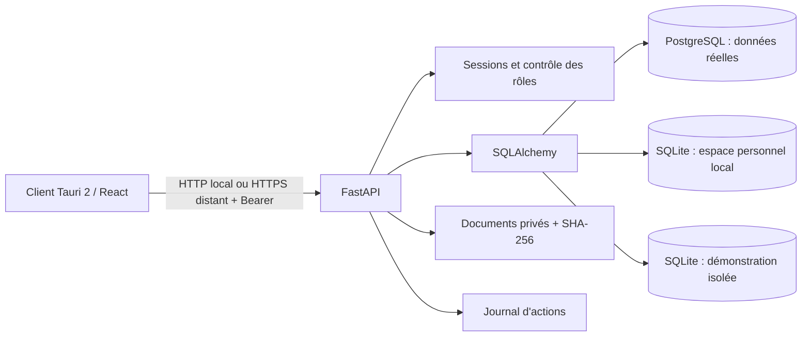
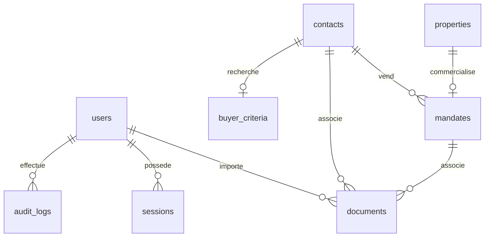

# Architecture — fondations et premiers modules commerciaux

## Organisation

```text
apps/desktop/
  src/                  React + TypeScript, composants, formulaires, client API
  src/components/ui/    Primitives de type shadcn, Radix Dialog, variantes CVA
  src-tauri/            Client Windows Tauri 2 et configuration NSIS
backend/
  app/config.py         Configuration serveur, séparation des modes
  app/models.py         Modèle relationnel SQLAlchemy
  app/schemas.py        Validation Pydantic des entrées
  app/main.py           API, authentification, autorisations et services phase 1
  app/commercial.py     Agenda, exports ICS, rapprochements et estimations
  app/commercial_schemas.py Validation des horaires, valeurs et comparables
  app/estimate_pdf.py   Rapport PDF local et polices ReportLab embarquées
  app/manage.py         Initialisation et création des comptes
  app/backup.py         Sauvegarde/restauration SQLite locale et de démonstration
  migrations/           Migrations Alembic versionnées
  tests/                Tests API, sécurité, persistance et sauvegarde
scripts/                Installation, lancement et PostgreSQL de test
tests/e2e/              Parcours navigateur Playwright
docs/                   Documentation technique et utilisateur
.local/                 Données et journaux locaux, ignorés par Git
```

React utilise Tailwind CSS 4, des primitives locales dans le style shadcn/ui (Radix pour les dialogues et la gestion du focus), Lucide et Recharts. Les textes et images système ne dépendent pas d’un CDN. Les visuels de biens sont des pictogrammes, pas des photographies inventées.

## Flux



Une instance correspond à l’espace métier d’un conseiller ou d’une petite équipe. Les rôles limitent les écritures ; ils ne cloisonnent pas les contacts entre utilisateurs. Ce n’est pas une architecture SaaS multi-tenant. L’introduction d’un SaaS nécessitera un identifiant d’organisation, une politique d’isolation et des tests dédiés.

La migration `20261021_commercial` ajoute `calendar_events` et `estimates`, avec contraintes métier, clés étrangères indexées et versions de dossiers. Les comparables d’une estimation sont un ensemble JSON borné à 30 références, validé avant stockage. L’agenda enregistre des instants UTC et affiche Europe/Paris. Les rapprochements sont recalculés depuis les dossiers courants ; ils ne contiennent aucune donnée collectée sur un portail. Les rapports PDF sont construits en mémoire, sans téléchargement de polices, ni accès aux URL déclarées dans les sources.

## Schéma relationnel initial



| Table | Rôle et contraintes |
|---|---|
| `installation` | Marqueur du mode de la base, contrôlé au démarrage |
| `users` | E-mail unique, hash Argon2, rôle, activation |
| `sessions` | Empreinte SHA-256 du jeton aléatoire, expiration UTC, index de recherche |
| `contacts` | Identité, coordonnées, rôle vendeur/acquéreur/professionnel, provenance, archivage |
| `buyer_criteria` | Une recherche par contact, budgets cohérents, surface et chambres positives |
| `properties` | Adresse, commune, type, surface, pièces, DPE |
| `mandates` | Référence unique, un bien par mandat dans cette version, vendeur, dates, prix et honoraires décimaux |
| `documents` | Métadonnées, associations FK, clé de stockage aléatoire, taille, SHA-256 |
| `audit_logs` | Acteur, action, identifiant de dossier, changements de prix/statut |
| `automation_settings` | Préférence générale, quota 17, relance 7 jours, maximum 1, Europe/Paris |

Les montants utilisent `NUMERIC`, pas des flottants dans la base. Les clés étrangères sont indexées ou couvertes par une contrainte d’unicité. Les suppressions de vendeurs/biens liés sont restreintes ; l’interface archive les contacts sans supprimer les dossiers. Le modèle des mandats garde les conditions intercabinets dans le mandat ; une table de partenaires multiples sera ajoutée quand le cas d’usage sera implémenté.

Les autres entités du cahier des charges seront introduites avec les services qui les utilisent. La phase 1 ne crée pas de fausses tables fonctionnelles pour des modules absents.

## Sécurité des flux

- Le frontend conserve le jeton uniquement en mémoire. Déconnexion = suppression de la session côté serveur.
- Sessions de 8 h par défaut. Mot de passe de 12 caractères minimum lors de la création par CLI.
- Toutes les routes métier vérifient la session ; chaque écriture exige `advisor` ou `admin`.
- Origines CORS explicites, écoute locale par défaut, pas de secrets dans le bundle.
- En mode local, création d’un unique propriétaire avec e-mail et mot de passe Argon2id ; contrôle de boucle locale et d’origine HTTP, clé de processus supplémentaire pour le client Windows. SQLite conserve le compte et les dossiers hors du dossier d’installation. Le mode local ne propose pas de connexion de démonstration.
- En mode réel, connexion de démonstration indisponible et PostgreSQL obligatoire.
- Marqueurs de mode sur la base et le dossier documentaire : une configuration incompatible est refusée.
- Fichiers limités à 15 Mo, noms de stockage aléatoires, signature initiale vérifiée, pas d’extraction automatique ni d’exécution de macros.
- Documents téléchargés comme pièces jointes `application/octet-stream`, jamais exécutés ou injectés en HTML.
- Les éléments textuels sont rendus par React sans `dangerouslySetInnerHTML`.
- Le CSV neutralise les préfixes de formule courants.

La vérification initiale du format n’est pas un antivirus. Un scan documentaire, les limites de requête au reverse proxy, la supervision et le chiffrement des volumes restent nécessaires avant hébergement de données réelles. Les journaux applicatifs ne sont pas un stockage d’audit immuable certifié.

## Contrats d’intégration futurs

Les connexions affichées par `/api/settings` ont toutes `can_send=false`. Le client ne dispose d’aucune route d’envoi. Les prochains connecteurs devront retourner un résultat technique vérifiable, distinguer `not_configured`, `blocked`, `ready` et `error`, et journaliser les autorisations et les réponses du fournisseur.

Charlie 0.6 est en lecture seule. `charlie.py` gère configuration et conversations ; `charlie_context.py` construit un contexte structuré borné et son empreinte ; `charlie_provider.py` appelle exclusivement l’API Responses OpenAI en HTTPS. Aucune exécution d’outil, lecture arbitraire de fichier ou requête SQL générée n’est autorisée. Les notes des dossiers sont traitées comme contenu non fiable. La réponse est affichée en texte React, sans injection HTML.

La migration `20261021_charlie` ajoute `ai_settings`, `ai_conversations` et `ai_turns`. Les conversations sont cloisonnées par utilisateur, contrairement aux dossiers CRM partagés. L’identifiant UUID de chaque demande et la réservation versionnée de la conversation sont enregistrés avant un appel externe ; répéter une demande identique déjà terminée ne refacture pas un appel. Un contexte changé depuis l’aperçu provoque un conflit explicite. Les échecs sont conservés sans réponse inventée ni repli silencieux.

Le mode local utilise des règles explicites sans modèle d’IA. Le mode OpenAI transmet seulement le message courant et le contexte affiché après confirmation ; aucun historique de conversation n’est exporté. `store: false` est demandé. `secret_store.py` chiffre la clé API avec Windows DPAPI pour l’utilisateur courant, sans repli en clair. Sur un serveur non Windows, seule la variable secrète backend est disponible. Les futurs outils d’action nécessiteront des permissions et confirmations distinctes.
