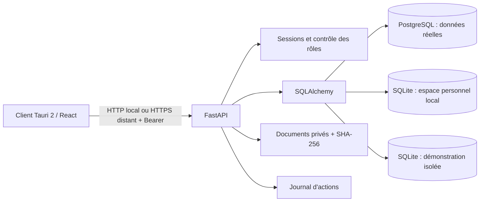
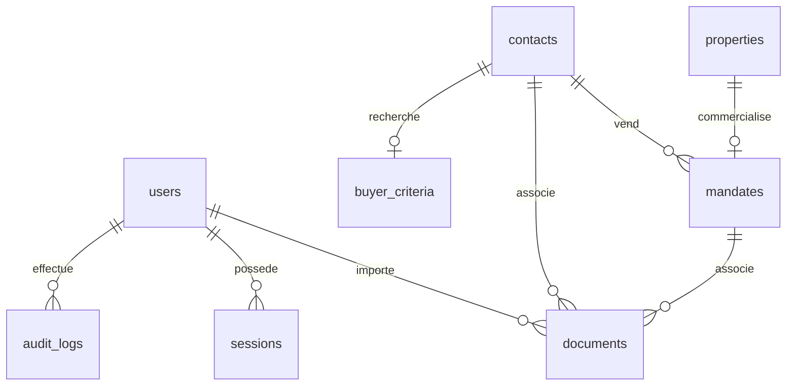

# Architecture — fondations et premiers modules commerciaux

## Organisation

```text
apps/desktop/
  src/                  React + TypeScript, composants, formulaires, client API
  src/components/ui/    Primitives de type shadcn, Radix Dialog, variantes CVA
  src-tauri/            Client Windows Tauri 2 et configuration NSIS
backend/
  app/config.py         Configuration serveur, séparation des modes
  app/models.py         Modèle relationnel SQLAlchemy
  app/schemas.py        Validation Pydantic des entrées
  app/main.py           API, authentification, autorisations et services phase 1
  app/commercial.py     Agenda, exports ICS, rapprochements et estimations
  app/commercial_schemas.py Validation des horaires, valeurs et comparables
  app/estimate_pdf.py   Rapport PDF local et polices ReportLab embarquées
  app/manage.py         Initialisation et création des comptes
  app/backup.py         Sauvegarde/restauration SQLite locale et de démonstration
  migrations/           Migrations Alembic versionnées
  tests/                Tests API, sécurité, persistance et sauvegarde
scripts/                Installation, lancement et PostgreSQL de test
tests/e2e/              Parcours navigateur Playwright
docs/                   Documentation technique et utilisateur
.local/                 Données et journaux locaux, ignorés par Git
```

React utilise Tailwind CSS 4, des primitives locales dans le style shadcn/ui (Radix pour les dialogues et la gestion du focus), Lucide et Recharts. Les textes et images système ne dépendent pas d’un CDN. Les visuels de biens sont des pictogrammes, pas des photographies inventées.

## Flux



Une instance correspond à l’espace métier d’un conseiller ou d’une petite équipe. Les rôles limitent les écritures ; ils ne cloisonnent pas les contacts entre utilisateurs. Ce n’est pas une architecture SaaS multi-tenant. L’introduction d’un SaaS nécessitera un identifiant d’organisation, une politique d’isolation et des tests dédiés.

La migration `20261021_commercial` ajoute `calendar_events` et `estimates`, avec contraintes métier, clés étrangères indexées et versions de dossiers. Les comparables d’une estimation sont un ensemble JSON borné à 30 références, validé avant stockage. L’agenda enregistre des instants UTC et affiche Europe/Paris. Les rapprochements sont recalculés depuis les dossiers courants ; ils ne contiennent aucune donnée collectée sur un portail. Les rapports PDF sont construits en mémoire, sans téléchargement de polices, ni accès aux URL déclarées dans les sources.

## Schéma relationnel initial



| Table | Rôle et contraintes |
|---|---|
| `installation` | Marqueur du mode de la base, contrôlé au démarrage |
| `users` | E-mail unique, hash Argon2, rôle, activation |
| `sessions` | Empreinte SHA-256 du jeton aléatoire, expiration UTC, index de recherche |
| `contacts` | Identité, coordonnées, rôle vendeur/acquéreur/professionnel, provenance, archivage |
| `buyer_criteria` | Une recherche par contact, budgets cohérents, surface et chambres positives |
| `properties` | Adresse, commune, type, surface, pièces, DPE |
| `mandates` | Référence unique, un bien par mandat dans cette version, vendeur, dates, prix et honoraires décimaux |
| `documents` | Métadonnées, associations FK, clé de stockage aléatoire, taille, SHA-256 |
| `audit_logs` | Acteur, action, identifiant de dossier, changements de prix/statut |
| `automation_settings` | Préférence générale, quota 17, relance 7 jours, maximum 1, Europe/Paris |

Les montants utilisent `NUMERIC`, pas des flottants dans la base. Les clés étrangères sont indexées ou couvertes par une contrainte d’unicité. Les suppressions de vendeurs/biens liés sont restreintes ; l’interface archive les contacts sans supprimer les dossiers. Le modèle des mandats garde les conditions intercabinets dans le mandat ; une table de partenaires multiples sera ajoutée quand le cas d’usage sera implémenté.

Les autres entités du cahier des charges seront introduites avec les services qui les utilisent. La phase 1 ne crée pas de fausses tables fonctionnelles pour des modules absents.

## Sécurité des flux

- Le frontend conserve le jeton uniquement en mémoire. Déconnexion = suppression de la session côté serveur.
- Sessions de 8 h par défaut. Mot de passe de 12 caractères minimum lors de la création par CLI.
- Toutes les routes métier vérifient la session ; chaque écriture exige `advisor` ou `admin`.
- Origines CORS explicites, écoute locale par défaut, pas de secrets dans le bundle.
- En mode local, création d’un unique propriétaire avec e-mail et mot de passe Argon2id ; contrôle de boucle locale et d’origine HTTP, clé de processus supplémentaire pour le client Windows. SQLite conserve le compte et les dossiers hors du dossier d’installation. Le mode local ne propose pas de connexion de démonstration.
- En mode réel, connexion de démonstration indisponible et PostgreSQL obligatoire.
- Marqueurs de mode sur la base et le dossier documentaire : une configuration incompatible est refusée.
- Fichiers limités à 15 Mo, noms de stockage aléatoires, signature initiale vérifiée, pas d’extraction automatique ni d’exécution de macros.
- Documents téléchargés comme pièces jointes `application/octet-stream`, jamais exécutés ou injectés en HTML.
- Les éléments textuels sont rendus par React sans `dangerouslySetInnerHTML`.
- Le CSV neutralise les préfixes de formule courants.

La vérification initiale du format n’est pas un antivirus. Un scan documentaire, les limites de requête au reverse proxy, la supervision et le chiffrement des volumes restent nécessaires avant hébergement de données réelles. Les journaux applicatifs ne sont pas un stockage d’audit immuable certifié.

## Partenaires et pilotage (0.9)

La migration `20261022_partners` crée `partners`, `referrals`, `referral_events` et ajoute une clé étrangère nullable `incomes.referral_id`. Les références existantes sont conservées, y compris revenus validés et encaissements. Les clés étrangères sont indexées. L’annuaire et les dossiers sont paginés (40, maximum 100), filtrés côté serveur ; la recherche échappe les caractères `%` et `_`. Les partenaires s’archivent sans supprimer leurs liens. La création d’un dossier et la première mise en relation utilisent les versions du partenaire et du contact pour éviter un archivage concurrent non détecté.

Les dossiers de courtage exigent un acquéreur et un partenaire de type courtier lors de leur création, changement de liens ou première mise en relation. Les dates effectuées ne sont pas futures. La première transmission déclarée exige une autorisation datée au plus tard le jour de transmission et une justification ; elle crée un snapshot des noms et de la déclaration, sans exécuter aucun envoi. Les liens, l’origine et les dates sont figés ensuite. Le retrait courant de l’autorisation reste possible, sans effacer cette trace. Les événements sont ajoutés dans la même transaction que les changements et présentent l’auteur, les champs concernés, l’étape et l’autorisation. Les 200 événements les plus récents et 200 revenus liés maximum sont consultables par dossier ; les données sous-jacentes restent conservées.

La validation d’un revenu lié confirme aussi la version du dossier partenaire dans le devis et modifie cette version à l’écriture. Les changements de contexte concurrents provoquent donc un conflit ; les liens des dossiers ayant un revenu validé restent figés. L’ajout d’une première transmission déclarée reste possible avec son autorisation, sans modifier les revenus existants ; sa date devient ensuite immuable. Un revenu est une ligne unique dans `incomes` : sa présence dans un dossier ne crée aucune copie ni agrégat financier supplémentaire. Les relations entre revenus, contacts et transactions sont vérifiées.

`pilotage.py` agrège des données existantes : stocks actuels toutes années, actes déclarés signés par date d’acte, moyenne compromis-acte et nombre d’échantillons, journal de prospection et agenda selon les bornes annuelles Europe/Paris converties en UTC. Prévisions, validations et encaissements sont regroupés séparément par mois, origine et base HT/TTC/contractuelle. Les versements sont attribués à leur propre date, même pour un revenu d’une autre année. Aucun chiffre d’affaires fiscal, taux de conversion causal ou succès d’envoi n’est calculé.

## Transactions et commissions (0.8)

La migration `20261022_finance` ajoute `sale_transactions`, `commission_plans`, `incomes` et `income_payments`. Un index unique partiel SQLite/PostgreSQL interdit plusieurs transactions non annulées pour un mandat. Les documents sont retrouvés par liens existants, sans copie. Les clés étrangères sont indexées ; les listes sont paginées (40 éléments, maximum 100 par requête). Le sélecteur de transactions récentes est limité à 100 mais préserve les liens existants hors liste ; les barèmes sont limités à 500 et l’export CSV à 2 000 revenus.

`commission_math.py` calcule avec Decimal et arrondi HALF_UP. Marginal : somme des tranches puis arrondi final. Global : différence des droits cumulés arrondis, permettant le rattrapage sans dérive des centimes. Les compteurs utilisent les assiettes des seuls revenus validés dans le même barème et la même période civile, avec reprise explicite éventuelle. Les prévisions stockent le dernier calcul ; elles ne réservent pas de cumul. Les calculs, périodes, taux et ajustements sont figés à validation. Aucun taux fiscal ni pourcentage de rémunération utilisateur n’est fourni par défaut.

Un digest lie le devis au revenu/version/calcul. La confirmation exige un devis actuel ; le barème est conservé dans la session et son compteur de version est modifié dans la même transaction pour sérialiser les validations concurrentes. Les encaissements font évoluer la version du revenu ; le contrôle du total et l’insertion sont atomiques. Des UUID identifient les validations et versements réessayés après perte de réponse. Les revenus validés et les versements sont conservés ; aucune correction/avoir ni suppression financière n’est exposée. Les lecteurs consultent, les conseillers écrivent, seuls les administrateurs créent les barèmes.

Le tableau agrège par HT/TTC/contractuel, séparément par dates prévisionnelles, de validation et d’encaissement ; le reste dû couvre toutes les années. Les valeurs ne constituent ni des factures ni des déclarations fiscales. Aucun accès bancaire ou envoi externe n’est implémenté.

## Radar, suivi et carte (0.7)

`radar.py` et `radar_schemas.py` séparent les annonces déclarées du portefeuille commercial. La migration `20261022_radar` crée `radar_listings`, `radar_prices`, `prospects`, `prospect_activities` et `outlook_settings`. Les clés étrangères sont indexées ou uniques ; versions de dossiers, contraintes et transactions empêchent les écrasements concurrents et imports partiels. La clé canonique SHA-256 d’URL ignore fragments et paramètres utm, préserve les identifiants de requête et refuse un doublon exact. Aucune URL n’est récupérée par le backend.

Le CSV est analysé et validé avant écriture, puis importé après confirmation des droits. Les doublons sont ignorés sans fusion. Les prix modifiés créent des observations appendues ; le journal d’audit conserve aussi prix/statut avant et après. Les listes sont paginées ; les événements nécessaires au résumé des prospects sont regroupés dans une requête, sans charger tous les messages de chaque suivi. Le détail affiche les 200 dernières activités, tout en conservant les précédentes et leurs effets sur les contrôles.

Une activité de prospection est une déclaration utilisateur, jamais une preuve technique d’envoi. Son UUID protège les nouvelles tentatives identiques ; les écritures concurrentes sont contrôlées par version. Les séquences excluent les professionnels, les vendeurs inconnus, les annonces retirées et les oppositions pour les déclarations de contact/relance. Les compteurs utilisent les bornes UTC du jour civil Europe/Paris. Le plafond de campagnes ne sera appliqué qu’avec un futur adaptateur d’envoi confirmé.

MapLibre et son worker ESM sont empaquetés dans le client ; aucune bibliothèque ni police n’est chargée depuis un CDN. Le module JS est chargé à l’ouverture de la carte. Les positions restent locales, sur un fond neutre par défaut. L’option OpenStreetMap ajoute seulement les tuiles raster du domaine autorisé par CSP, avec attribution et cache du navigateur ; pas de préchargement ni téléchargement hors ligne. Le client Windows identifie l’application dans son User-Agent. Les marqueurs utilisent du texte DOM, sans injection HTML des annonces. Les tests interceptent les tuiles et ne contactent pas OSM.

`outlook_setup.py` conserve seulement le client ID et le locataire d’une future application publique. Les autorités sont limitées aux audiences Microsoft connues ou à un UUID ; aucun secret client, jeton ni mot de passe Microsoft n’est stocké. Les états `connected`, `can_send` et `authorization_available` restent faux.

## Intégrations externes

Les connexions affichées par `/api/settings` ont toutes `can_send=false`. Le client ne dispose d’aucune route d’envoi. Les prochains connecteurs devront retourner un résultat technique vérifiable, distinguer `not_configured`, `blocked`, `ready` et `error`, et journaliser les autorisations et les réponses du fournisseur.

Charlie 0.6 est en lecture seule. `charlie.py` gère configuration et conversations ; `charlie_context.py` construit un contexte structuré borné et son empreinte ; `charlie_provider.py` appelle exclusivement l’API Responses OpenAI en HTTPS. Aucune exécution d’outil, lecture arbitraire de fichier ou requête SQL générée n’est autorisée. Les notes des dossiers sont traitées comme contenu non fiable. La réponse est affichée en texte React, sans injection HTML.

La migration `20261021_charlie` ajoute `ai_settings`, `ai_conversations` et `ai_turns`. Les conversations sont cloisonnées par utilisateur, contrairement aux dossiers CRM partagés. L’identifiant UUID de chaque demande et la réservation versionnée de la conversation sont enregistrés avant un appel externe ; répéter une demande identique déjà terminée ne refacture pas un appel. Un contexte changé depuis l’aperçu provoque un conflit explicite. Les échecs sont conservés sans réponse inventée ni repli silencieux.

Le mode local utilise des règles explicites sans modèle d’IA. Le mode OpenAI transmet seulement le message courant et le contexte affiché après confirmation ; aucun historique de conversation n’est exporté. `store: false` est demandé. `secret_store.py` chiffre la clé API avec Windows DPAPI pour l’utilisateur courant, sans repli en clair. Sur un serveur non Windows, seule la variable secrète backend est disponible. Les futurs outils d’action nécessiteront des permissions et confirmations distinctes.
